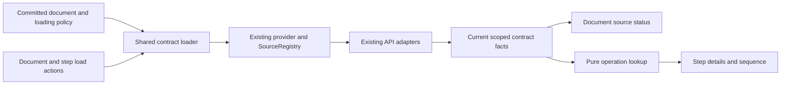

## Context

See proposal.md for the reader problem. The current implementation already has the necessary acquisition and projection pipeline:

- `ArazzoUIStandalone.tsx` supplies a memoized BrowserFetchProvider; `ArazzoUI` accepts an optional host provider. The document branch and catalog branch are separate; catalog selection renders ArazzoUI with its supplied revision authority.
- `ContractFactsContext.tsx` owns session-shared projections, source revision pins from SourceRevisionContext, request tokens, and validity filtering. Only ContractPanel currently calls its load action. Opening a step alone deliberately performs no acquisition.
- `SourceRegistry` owns URI resolution, caching/deduplication, provider generations, dependency invalidation, redirect aliases, cancellation, and the default bounds: four concurrent acquisitions, 32 documents, eight reference hops, and 10 MiB per document. BrowserFetchProvider supports HTTP(S), omits credentials, and obeys browser CORS.
- `InspectionStatus.tsx` derives availability from registry entries, which can describe retrieved bytes without successful supported projection and currently omits revision-specific lookup. ContractPanel and SequenceView already consume shared current projections and pure operation resolution.
- DocsView memoizes authored documentation separately from live contract facts. `markdownFormatter.ts` prints permanent unverified source cards and, when support output is enabled, states that sources were not fetched. The semantic snapshot also contains authored-only source-verification limitations; those are not live acquisition state.
- Existing specs prohibit automatic fetching in several places. The four deltas revise that contract explicitly while preserving every existing scenario of modified requirements.

Current evidence from the investigation: loading the digital-product YAML through the content pipeline made zero API-provider calls; explicitly acquiring/projecting its four local descriptions yielded OpenAPI 3.1.0 and six located API operations. Fifteen focused contract/status tests passed. This is local adapter/component evidence, not a browser walkthrough: no connected browser or localhost:3000 server was available. No HTTP-success or reader-comprehension claim follows from it.

## Goals / Non-Goals

**Goals:** Put acquisition policy at the viewer boundary; reuse one current loading/projection owner; make the document-level API action discoverable without adding an expanded source dashboard to ordinary reading; separate source availability, operation lookup, and semantic inspection scope.

**Non-Goals:** Full Arazzo/OpenAPI validation; API execution; credentials configuration UI; a new URL/base editor; guessing sibling contracts, guides or participant metadata; automatic external-workflow expansion/navigation; catalog enumeration or historic revision-fetch changes; replacing SourceRegistry or adapters; introducing a persistent cache, polling, loading preferences in URLs, or new dependencies.

## Decisions

### 1. One loading-policy prop, with entry-point defaults

Add optional `apiDescriptionLoading?: 'manual' | 'automatic'` to ArazzoUIProps in `types/viewer.ts`, threading it through the viewer context to ContractFactsProvider. ArazzoUI defaults to manual, even when a provider exists. The document branch of ArazzoUIStandalone forwards an explicit host value or automatic. Catalog/review retain their current authority/defaults; this change does not automatically enumerate more catalog documents or obtain historic bytes. A selected embedded viewer can opt into automatic using its supplied authority and source revision pins.

The automatic eligibility set is declared OpenAPI under supported Arazzo 1.0/1.1 inspection and declared AsyncAPI under selected 1.1 inspection. Attempt each eligible declaration whether or not the current workflow uses it, so document coverage is meaningful and unqualified operation lookup does not depend on the selected step. Unknown kinds, duplicate-name declarations, incompatible source kinds/profile, and unsupported Arazzo profiles get explanations rather than guessed adapters or automatic requests. Unsupported OpenAPI/AsyncAPI contract versions discovered after retrieval remain acquired-but-unsupported with raw content available. External Arazzo loading/navigation remains the existing explicit action.

Automatic mode works for URL documents, restored document links, explicit base-bearing uploads/inline objects, and absolute declared source URLs. Missing supported bases remain failures/limitations with no viewer-page or filesystem fallback. Unsupported `$self`/identity semantics must continue to be diagnosed rather than resolved against a known-wrong identity. No special digital-product path or filename check is permitted.

Changing a host policy from automatic to manual prevents future automatic attempts; already authorized in-flight attempts can settle. Replacing the document/provider/revision cancels obsolete acquisition and excludes stale results under the existing stronger scope rules. There is no reader-facing policy switch and no new persistent preference.

Alternative: automatically fetch whenever any provider exists. Rejected because provider availability is not host permission for background activity. Alternative: visible manual bulk loading only. It improves discovery but leaves ordinary standalone entry requiring an unnecessary action for its declared APIs. One prop supports the useful conservative host behavior and the requested standalone default without separate loading systems.

### 2. Start background work in the shared contract owner

Extend ContractFactsProvider's current loader instead of adding fetches to status components, step selection, or source binding. Begin automatic work after a supported primary model is committed and the registry has installed its configured provider; never delay publishing the primary document. Account for hook setup ordering and React StrictMode so the first batch cannot fail against an uninitialized registry or be restarted by effect replay.

An initial automatic attempt is keyed by snapshot scope, provider identity/generation, declaration identity, and requested revision. Retain attempt completion/failure independently of whether current facts later become invalid. An idempotent ordinary Load shares an in-flight/current projection; explicit Retry/Reload starts the intentional fresh attempt. Preserve content/error provenance, original URI, returned URI, revision pins, dependency validity, and request-token checks across the entire asynchronous adapter projection, not just the physical acquisition.

Physical requests and supported contract reference dependencies use the existing active registry budgets. Automatic failure settles visibly; no periodic or render-triggered retry. A bulk manual load attempts eligible unattempted sources, not successful, already-loading, failed, or invalidated sources. Retry is source-specific. Explicit Reload refreshes the selected source and dependencies through existing invalidation behavior. Other affected sources lose stale facts and expose Load; unrelated projections remain current. Automatic mode does not restart its batch solely because reload invalidated a fact, preventing shared-dependency cycles.



Alternative: a parallel source-state store in InspectionStatus. Rejected because it would repeat the acquired-bytes/projected-contract mismatch and create inconsistent invalidation. Keep projection state in the existing context; a small shared display projection is justified for labels used by multiple surfaces, but do not build a new acquisition abstraction.

### 3. One compact document-level API surface

Evolve the existing shared InspectionStatus surface rather than placing another persistent toolbar above the sequence. For documents with API declarations, its directly visible disclosure is named **API descriptions**, followed by current counts. It is in the shared viewer shell beside the normal reading controls, available in All workflows and every ordinary reading mode, and appears once in Split. Status counts retain unsupported/unknown declaration coverage; external Arazzo sources are separately identified in the list and excluded from the API-loaded denominator. Without API declarations, retain a compact Inspection status entry for scope instead of an empty API panel.

Example collapsed and expanded states:

```text
API descriptions · 3 of 4 loaded · 1 failed

API descriptions
  coordinator   OpenAPI 3.1.0   Loaded    Reload
  inventory     OpenAPI 3.1.0   Loaded    Reload
  payment       OpenAPI        Failed    Retry
    Could not load the API description: <specific provider error>
  license       OpenAPI 3.1.0   Loaded    Reload

  Inspection scope ▸
```

Manual entry with unattempted sources offers **Load API descriptions**, followed by individual **Load API description <name>** actions. During loading, display **Loading** without disabling workflow controls or moving focus. After success, display **Loaded** and the parsed contract profile; failure offers Retry; unsupported content says Unsupported with the exact limitation and available provenance/raw bytes. Provider absence says Loading unavailable with no ineffective action. Avoid a green verified badge or implying that a loaded source has all operations present.

Each source exposes authored name, kind, and URL. Source URLs remain ordinary raw-document links with distinct accessible names; Load/Retry/Reload are buttons that keep the reader in the workflow. Source acquisition details and raw content are secondary disclosures. The first usable source action is above generic inspection scope and technical prose. ContractPanel keeps its contextual operation result, but repeats the same source status/action logic rather than owning acquisition.

Document information in DocsView reuses the live source-list rendering where available, with no second persistent summary. An open list uses contained scrolling and normal viewer styles; long URLs/names wrap. Preserve existing 60 percent reading-height budget, untouched Petstore first-screen interaction/continuation, 12-pixel text, and narrow embedded sizing. Use native disclosure behavior where it already fits. Keep focus in a stable source context while an action is disabled or relabelled, do not collapse a disclosure on completion, and do not announce every dependency update as a new live alert. Do not duplicate document-level controls in Split.

Alternative: keep the primary action at the bottom of step details and improve help text. Rejected because finding a document-level resource must not require knowing which step opens its loader. Alternative: expanded source rows above every diagram. Rejected because sources should remain discoverable without displacing ordinary workflow reading.

### 4. Current source state and inspection scope are separate

Derive live availability from current ContractFactsContext projections and their provenance, with registry entries supplying acquisition explanation when needed. A registry `located` entry alone is not a supported Loaded description. Use requested revision pins and existing freshness checks; never retrieve an arbitrary unpinned cached entry for a pinned declaration. Duplicate declaration names remain explicit ambiguity instead of sharing a misleading name-keyed result.

The summary and document source list show description availability. `resolveStepOperation` and `contractReadingStatus` continue to describe operation results independently: a Loaded source can yield Operation not found or Multiple matching operations. Sequence destinations only gain current evidence when relevant candidate coverage is complete. Preserve authored qualification diagnostics, step IDs, repeat occurrence identity, and actor/ownership rules.

Keep the Arazzo snapshot's static support/limitations immutable. Interactive status replaces blanket unfetched claims with live coverage, and nests applicable Arazzo 1.1/resolution/validation/execution limitations beneath **Inspection scope**. Do not remove genuine missing references or unsupported-profile diagnostics because sources loaded successfully. Static `generateDocumentation` remains authored-only unless its existing contract explicitly supplies equivalent evidence: use **Declared OpenAPI source** or the authored kind for cards, and replace categorical not-fetched claims with a concise authored-only evidence-scope explanation. It must not invent current live status or inherit loaded claims from a different viewer.

Audit the support text and copied `support.limitations` in docGenerator as well as source cards and formatter paragraphs: changing only the visible card would leave the same false unfetched claim in another export section. Restate/filter acquisition-specific snapshot limitations for the authored-only output while preserving actual semantic/profile limits and the underlying snapshot.

Alternative: change `sourceVerification` to verified after any fetch. Rejected because it would equate retrieval with contract validity and corrupt authored-only semantic provenance. Alternative: inject current request state into all generated strings. Rejected because static exports do not have a live acquisition lifecycle; interactive status belongs in the shared live surface.

### 5. Verify behavior and discoverability separately

Add focused regressions for policy defaults/overrides; initial registry readiness/StrictMode; real digital-product API projections; no implicit primary-schema/external-Arazzo/sibling requests; provider denials; absent bases; supported/unsupported profiles; partial/duplicate operation coverage; shared in-flight actions; revision/provider/document replacement; dependency invalidation; and bounded failure without retry loops. Reuse `contract-panel.test.tsx`, `resolution-status.test.tsx`, `documentation.test.ts`, existing source/contract tests, and standalone test patterns, adding a dedicated policy/status test file only where it keeps these cases coherent.

Update production-browser cases in `test/e2e/production.spec.ts` that currently assume a standalone Load button; require current automatic success instead, and retain explicit-loading cases under manual configuration. Exercise unchanged Petstore, the small digital-product example, all nine inventoried digital-product/stress documents, long source names, mixed AsyncAPI/Arazzo documents, and injected slow/failing descriptions at 1440×1000 and 480×900. Record no-step source discovery, loading while reading, a failed-source Retry, loaded-but-missing operation, view changes, and keyboard focus. Use local fixtures/interception so tests do not depend on illustrative example.test API servers or mutable remote contract availability.

Record unfamiliar API Owner/Developer feedback in this change's `evidence/human-results.md` during implementation: find API availability from untouched entry, recover a failed source without step-specific training, and explain Loaded versus Operation found versus full validation. Use recorded unassisted sessions or explicit user-confirmed feedback; report assistance and failures. Engineering/browser checks do not close human UX acceptance. Keep that task unchecked until actual evidence exists. No reader test or visual acceptance is claimed by this proposal.

## Risks / Trade-offs

- [Standalone now makes additional declared-source requests] → Mark the default change in release/docs guidance; support the manual override; retain provider authority, omitted browser credentials, CORS, and existing bounds. Hosts needing stricter network policy supply their own provider.
- [Many sources compete for limited resources] → Render workflow reading first; use bounded registry acquisition and visible limit states; never expand budgets to make examples appear green.
- [Lifecycle changes cause duplicate requests or stale projections] → Centralize idempotent loading, gate registry readiness, retain tokens/pins/dependency validity, and test effect replay and delayed replacement explicitly.
- [Status claims outrun projection or revision authority] → Read current scoped projections, separate unsupported/parse failure from acquired bytes, and preserve operation-coverage uncertainty.
- [The new surface crowds narrow reading] → Keep one collapsed summary, reuse shell layout, contain the expanded list, and enforce existing entry-screen budgets with fresh captures.
- [Historic or external content is accidentally broadened] → Scope the automatic policy to the document viewer's declared eligible APIs; retain catalog/revision authority and explicit external-workflow navigation.

## Migration Plan

Implement only after a separate apply request. Add the prop and shared loader first, then the document source surface and live/static wording, then adjust relevant tests and README. Existing ArazzoUI consumers keep manual behavior without changes. ArazzoUIStandalone document consumers wanting former behavior set `apiDescriptionLoading="manual"`; document the new default prominently. No YAML examples, main specs, location encodings, data migration, or dependency installation is needed.

Validate focused regressions, UI types/full tests/lint/build, generated public declarations and packed consumers, production-browser checks, strict OpenSpec, and whitespace. Record engineering and human evidence independently. A host can roll back request behavior through the manual override; reverting the implementation restores prior defaults. Archive/sync, Git commits, publication, and integration remain separate explicit lifecycle actions.
