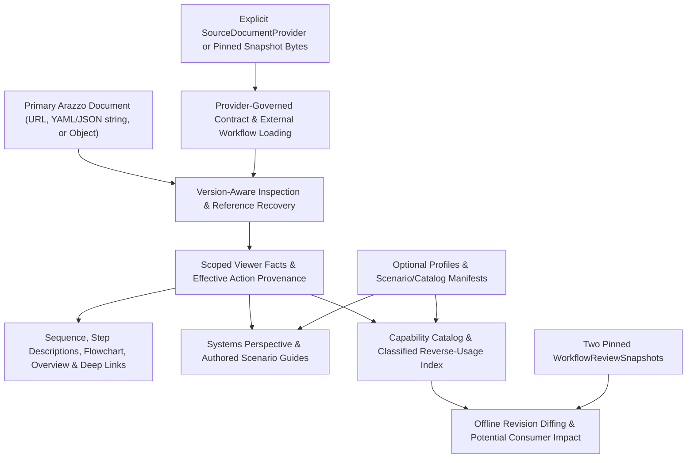

# Chained Workflow Visualization, Inspection, and Review (`@jentic/arazzo-ui`)

This feature expands `@jentic/arazzo-ui` from a single-workflow viewer into a comprehensive inspection, navigation, and revision-review suite for multi-workflow [Arazzo Specification](https://spec.openapis.org/arazzo/latest.html) documents and their linked OpenAPI / AsyncAPI contracts.

All existing entry points (`@jentic/arazzo-ui`, `@jentic/arazzo-ui/standalone`, `@jentic/arazzo-ui/styles.css`, UMD globals, and CLI), view modes (`diagram`, `docs`, `split`), imperative ref methods, and callback signatures remain backward-compatible. New capabilities are either built into the core reading flow or progressively disclosed when a host or user supplies optional configuration.

---

## Capabilities Overview

### 1. Core Viewer Enhancements (Zero-Config)

| Capability | What It Delivers |
| :--- | :--- |
| **Chained Workflow Visualization** | **All workflows** overview across `docs`, `diagram`, and `split` modes with on-demand relationship disclosures (`call`, `prerequisite`, `goto`, `retry`) alongside the relationship graph. Inline sequence expansion for chained local calls with per-occurrence state, **Open workflow** drill-down, and **Back to caller** return navigation. |
| **Sequence-First Reading & Inspector** | Bare viewer entry opens the first workflow's **Sequence diagram** immediately (retaining $\ge 60\%$ viewport height for reading at both `1440×1000` and `480×900`). **Sequence diagram** and **Step descriptions** (with the connected numbered Jentic timeline) are primary controls; **Workflow diagram**, **Flowchart**, and **Side by side** live under **More views**. Activating any step, operation, or call identity opens its scoped **Selection Details** inspector. |
| **Exact Locations & Deep Links** | Versioned `WorkflowLocation` contract and URL codec that address the document, optional revision/SHA-256 authored digest, root workflow or overview, view/subview, and exact call-path occurrence (`[{ workflowId, stepId }, ...]`) or action declaration/use pointer. Supports standalone **Copy link** and browser `Back`/`Forward` history without mutating history in embedded hosts. |

### 2. Opt-In Host & Portfolio Capabilities

| Capability | Activation | What It Delivers |
| :--- | :--- | :--- |
| **API Contract Inspection** | Explicit **Load API description** action (via standalone `fetch` or host `sourceProvider`) | Resolves step operation locators against OpenAPI 3.0/3.1, AsyncAPI 3.0, and external Arazzo sources. Displays HTTP parameters, request schemas, response alternatives, and security, or AsyncAPI send/receive direction, channels, message payloads, and correlation rules beside the step. |
| **Systems Perspective** | `viewProfile` prop, `viewProfileAdapter="digital-product"`, or `?profile=` / `?systemsProfile=` | Renders interactions across explicitly declared business participants, separating **workflow/step actors**, **API source owners**, and **organizational owners**. Supports descriptive operation-to-workflow implementation nesting and verified producer/consumer event links. |
| **Authored Scenario Guides** | `scenarioManifest` prop, `?scenarios=`, or **Help and guides → Load guides** | Turns authored scenario manifests into step-by-step **Guided walkthroughs** with assumptions, expected outcomes, and ordered `WorkflowLocation` waypoints with JSON Pointer focus (`parameter`, `payload`, `output`, `criterion`, `action`). |
| **Workflow Capability Catalog** | `ArazzoCatalog` component (`@jentic/arazzo-ui/catalog`) or `?catalog=` | Indexes a supplied multi-document `WorkflowCatalogManifest` across pinned revisions. Supports filtering by capability, product, workflow role (`entry`, `helper`, `diagnostic`), team owner, lifecycle, and API operation, plus reverse usage and classified entry-point paths. |
| **Workflow Revision Review** | `ArazzoWorkflowReview` component, `compareWorkflowRevisions()`, `exportWorkflowReview()` | Compares two immutable `WorkflowReviewSnapshot` bundles offline. Reports semantic before/after differences across workflows, steps, mappings, recovery policies, and referenced contract schemas, traces shared default action changes to effective step users, and exports deterministic JSON or Markdown reports. |

---

## Core User Experience & Behavioral Details

### Sequence-First Reading & Progressive Disclosure
- **Immediate first interaction:** Opening an Arazzo document with no explicit `view`/`initialView` or location opens the first workflow's **Sequence diagram**. Unchanged single-source documents (such as the default Arazzo 1.0.1 Petstore workflow) bind their operations to the declared API source (`petstoreAPI`) without fetching external contracts and render the first interaction immediately without scrolling past document metadata.
- **Explicit precedence:** Supplying `view`, `initialView`, or a restored `WorkflowLocation` honors the requested representation (`docs` opens **Step descriptions**).
- **Clean default chrome:** Document metadata, source declarations, search, and standalone document loading are on-demand disclosures. When no `scenarioManifest` or `viewProfile` is configured, no empty guide banner or disabled Systems promotion occupies reading space; optional capabilities are explained inside **Help and guides** / **More views**.

### Occurrence-Scoped Chaining & Details
- **Distinct repeated calls:** When a workflow calls the same helper workflow multiple times (e.g., `batch-fulfilment` calling `fulfil-item` at `first-item` and `second-item`), each call occurrence maintains its own expansion state, caller-to-callee input/output mappings, and location address.
- **Prerequisites and numbered steps:** Sequence reading places workflow prerequisites before step `1` and step prerequisites immediately before their owning step as unnumbered dependency annotations. Conditional recovery and retry actions appear as subordinate disclosures beneath their owning numbered step rather than extra numbered operations.
- **Viewer inspection order for actions:** Success and failure actions are separated by channel and listed in **viewer inspection order**: step-level actions in authored order, followed by unmatched workflow-level default actions (matched by action `name` and `type` within the same channel). Inherited and overridden provenance is labeled explicitly without predicting runtime runner branch selection.
- **Container-aware inspector modality:** When the details inspector covers the usable reading area (on narrow viewports $\le 600\text{px}$ or narrow embedded containers), it acts as a modal dialog that traps `Tab`/`Shift+Tab` focus and disables background controls until dismissed with `Escape` or **Close details**, restoring focus to the initiating identity control. When side-by-side reading space is available, the inspector remains non-modal.
- **Full-document search:** **Search workflows and steps** performs case-insensitive matching across workflow IDs, step IDs, titles, summaries, and authored operation locators across the entire document, including steps beyond the 200-row sequence canvas budget.

---

## Architecture & Module Seams

`@jentic/arazzo-ui` layers inspection and review over `@jentic/arazzo-parser` and `@jentic/arazzo-resolver` without introducing a workflow execution engine or runtime validator.



| Internal Seam | Responsibility |
| :--- | :--- |
| **Acquisition (`src/utils/loading`, `src/utils/source`)** | Enforces a single source authority (`SourceDocumentProvider`) across Arazzo, OpenAPI, AsyncAPI, catalog indexing, and pinned revision review. Tracks revision provenance, concurrency/byte/depth budgets, cancellation, and dependency invalidation. |
| **Inspection (`src/utils/contract`, `src/utils/model`)** | Preserves authored values (`0`, `false`, `null`, `""`, unevaluated expressions, unknown fields, `x-` extensions). Recovers gracefully from missing reusable `$components` references and distinguishes structural contract `$ref` edges from literal `$ref` data inside examples, defaults, or extensions. |
| **Shared Facts (`src/context`, `src/utils/model`)** | Computes occurrence-scoped step identities, effective action inheritance, and unique operation destinations when all candidate API sources have been checked. |
| **Presentation (`src/components`, `src/nodes`, `src/edges`)** | Renders finite, accessible views (12px minimum diagram text, contained scroll regions, localized flowchart error recovery) over unchanged authored documents. |
| **Catalog & Review (`src/utils/catalog`, `src/utils/review`)** | Indexes each supplied document revision independently, computes bounded entry-point reachability paths, and diffs baseline vs. candidate snapshots offline. |

Internal inspection models, native ApiDOM snapshots, source registries, scene graphs, and catalog indexes remain strictly private and are excluded from generated `.d.ts` rollup declarations.

---

## Design Invariants & Safety Guardrails

1. **Authored Fidelity, Never Simulated Execution:**
   - The UI presents authored workflow declarations and supplied contract definitions. It never executes HTTP requests against business APIs, evaluates runtime expressions, selects a winning runtime branch, or claims that viewing/exporting a workflow certifies schema conformance or backward compatibility.
   - Supported inspection profiles cover **Arazzo 1.0.x**, **selected Arazzo 1.1 features** (step prerequisites, action parameters, `querystring`, and asynchronous `send`/`receive`, `channelPath`, `timeout`, and `correlationId` metadata), **OpenAPI 3.0/3.1**, and **AsyncAPI 3.0**. Parseable unknown versions fall back to raw authored inspection with a diagnostic.
2. **Explicit Source Authority:**
   - Opening a document or selecting a step never triggers background contract fetches. Secondary documents and external `$ref` dependencies load only when explicitly requested through the active `SourceDocumentProvider`.
   - Provider denial or failure never falls back to direct browser `fetch` or filesystem access. Pinned revision review resolves dependencies exclusively from supplied snapshot bytes.
3. **Explicit Actor & Ownership Boundaries:**
   - In **Systems view** and **ArazzoCatalog**, **system actors** (who performs a step), **API source owners** (which participant owns an API contract), and **organizational owners** (which team owns a workflow) are kept distinct.
   - Expanded helper workflows and descriptive implementation workflows require an explicit step or workflow actor binding in `WorkflowViewProfile`; unbound steps remain visibly `Unknown` rather than inheriting their caller's actor.
4. **Justified Consumer & Revision Impact:**
   - In catalog reverse usage and revision review, direct operation uses and transitive entry-point paths retain their relationship class (`call`, `prerequisite`, `goto`, `retry`, `descriptive`).
   - Changes to shared workflow default actions implicate only steps that effectively inherit that default (excluding steps that override it and unrelated workflows in the same file). Incomplete source coverage is labeled explicitly so empty results under partial coverage are never mistaken for "no consumers."
5. **Finite Resource & Rendering Budgets:**
   - **Sequence & Systems scenes:** Max 8 nested call levels, 200 rendered rows, and cycle stop markers (with links to open deeper workflows as a new root or view full documentation).
   - **Location codec:** Max 16 KiB decoded JSON, 32 call-path hops, and 32 extension nesting levels; stale or removed occurrences stop at the valid root with an explanation instead of falling back to a namesake step.
   - **Source registry:** Max 4 concurrent fetches, 32 documents, 8 reference hops, and 10 MiB per document.
   - **Catalog & Review traversal:** Max 100 document revisions, 64 MiB aggregate content, 10,000 steps, 10,000 visited relationships, 100 displayed paths, and 32 hops per path.

---

## Public Interface Summary

### Package Exports & Dependencies
- **Entry points (`package.json`):**
  - `@jentic/arazzo-ui` (ESM + CJS/UMD + `./types/arazzo-ui.d.ts`)
  - `@jentic/arazzo-ui/standalone` (ESM + CJS/UMD + `./types/arazzo-ui-standalone.d.ts`)
  - `@jentic/arazzo-ui/catalog` (Typed ESM-only subpath exporting `ArazzoCatalog` and catalog types)
  - `@jentic/arazzo-ui/styles.css` (`./dist/arazzo-ui.css`)
- **Runtime dependencies:**
  - Declares `@speclynx/apidom-reference` (`^5.0.1`) directly (previously transitive) for the private provider-governed reference bridge.
  - Aligns `@speclynx/apidom-parser-adapter-yaml-1-2` to `^5.0.1` alongside the rest of the `@speclynx/apidom-*` family so fresh downstream installs resolve a consistent `web-tree-sitter` language version.

### Additive Props, Components & Utilities

| Surface | Exported Symbols / Props |
| :--- | :--- |
| **Viewer Navigation & Edges** | `activeWorkflowId={null}` selects **All workflows** (`onWorkflowSelect` emits `''` for overview); `selectedNodeId={null}` / `ref.clearSelection()` clears selection; `onEdgeSelect` adds the `relationship` edge variant (`RelationshipEdgeData` with `kind: 'prerequisite' \| 'call' \| 'action'`). |
| **Locations (`WorkflowLocation`)** | Props: `location`, `defaultLocation`, `onLocationChange`, `onLocationStatus`, `documentIdentity`, `documentRevision`, `locationAdapters`. Utilities: `encodeLocation`, `decodeLocation`, `readLocationURL`, `writeLocationURL`, `authoredDigest`, `createLocationAdapter`. |
| **Contract Inspection** | Props: `sourceProvider` (`SourceDocumentProvider`), `onExternalNavigation`. Types: `SourceDocumentRequest`, `SourceDocumentContent`, `SourceProvenance`, `ExternalWorkflowNavigationRequest`. |
| **Systems Perspective** | Props: `viewProfile` (`WorkflowViewProfile`), `viewProfileAdapter` (`'digital-product'`), `perspective` (`'workflow' \| 'systems'`), `onPerspectiveChange`. Helper: `digitalProductProfile()`. |
| **Scenario Guides** | Props: `scenarioManifest` (`ScenarioManifest`), `scenarioManifestURI`, `scenarioSelection`, `onScenarioSelectionChange`, `onScenarioLocationRequest`. |
| **Capability Catalog** | Component: `ArazzoCatalog`. Standalone prop: `catalog`, `catalogSelection`, `onCatalogSelectionChange`. Utility: `normalizeCatalogManifest`. Types: `WorkflowCatalogManifest`, `CatalogSelection`, `CatalogCoverageReport`, etc. |
| **Revision Review** | Component: `ArazzoWorkflowReview`. Utilities: `compareWorkflowRevisions`, `exportWorkflowReview`. Types: `WorkflowReviewSnapshot`, `WorkflowRevisionComparison`, `WorkflowReviewOptions`, etc. |

Full prop tables and copy-pasteable usage examples are documented in [`packages/jentic-arazzo-ui/README.md`](../../packages/jentic-arazzo-ui/README.md).

---

## Bundle Cost & Downstream Tree-Shaking

Detailed methodology and tarball hashes are recorded in [`packages/jentic-arazzo-ui/docs/package-cost.md`](../../packages/jentic-arazzo-ui/docs/package-cost.md). Using an identical downstream Vite + React 19 production consumer graph against the upstream baseline (`49dd8ef8`):

| Installed Consumer Workload | Baseline Initial JS (gzip) | Current Initial JS (gzip) | Delta | Initial CSS (gzip) |
| :--- | ---: | ---: | ---: | ---: |
| **Minimal embedded viewer (`ArazzoUI` only)** | 1,373,961 B | 1,413,217 B | **+39,256 B (+2.9%)** | 4,678 B |
| **Direct standalone (`ArazzoUIStandalone`)** | 1,377,388 B | 1,428,389 B | **+51,001 B (+3.7%)** | 4,678 B |
| **Deferred standalone (`React.lazy`)** | 60,245 B | 60,245 B | **0 B (0.0%)** | 6,176 B |

- **Zero catalog/review retention in minimal consumers:** `ArazzoCatalog`, `ArazzoWorkflowReview`, `compareWorkflowRevisions`, `buildCatalogIndex`, and `loadCatalog` are completely tree-shaken out of minimal `ArazzoUI` consumers, and OpenAPI/AsyncAPI contract adapters remain in deferred chunks until source inspection is used.

---

## Verification & CI Gates

Two new CI jobs in [`.github/workflows/build.yml`](../../.github/workflows/build.yml) (`public-package-acceptance` and `production-browser-acceptance`) complement the standard monorepo build, lint, test, and typecheck pipeline.

To run the full verification suite locally from a clean checkout:

```sh
nvm use
npm ci

# 1. Monorepo build, declarations, lint, unit tests, and type checks
npm run build:es
npm run typescript:declaration
npm run lint
npm test
npm run typescript:check-types

# 2. UI bundle build & public API declaration boundary check
npm run build -w @jentic/arazzo-ui
npm run test:declarations -w @jentic/arazzo-ui

# 3. Packed downstream consumer acceptance (ESM, UMD, CSS, ./catalog, and fresh unpinned SpecLynx install)
npm run test:package -w @jentic/arazzo-ui

# 4. Production Chromium browser acceptance (1440px & 480px across Petstore + 9 digital-product/stress docs = 46 workflows)
npx playwright install chromium
npm run test:browser -w @jentic/arazzo-ui

# 5. Negative fault-detection gate (proves deterministic failure on 5 isolated UX/semantic regressions)
npm run test:browser:negative -w @jentic/arazzo-ui
```
